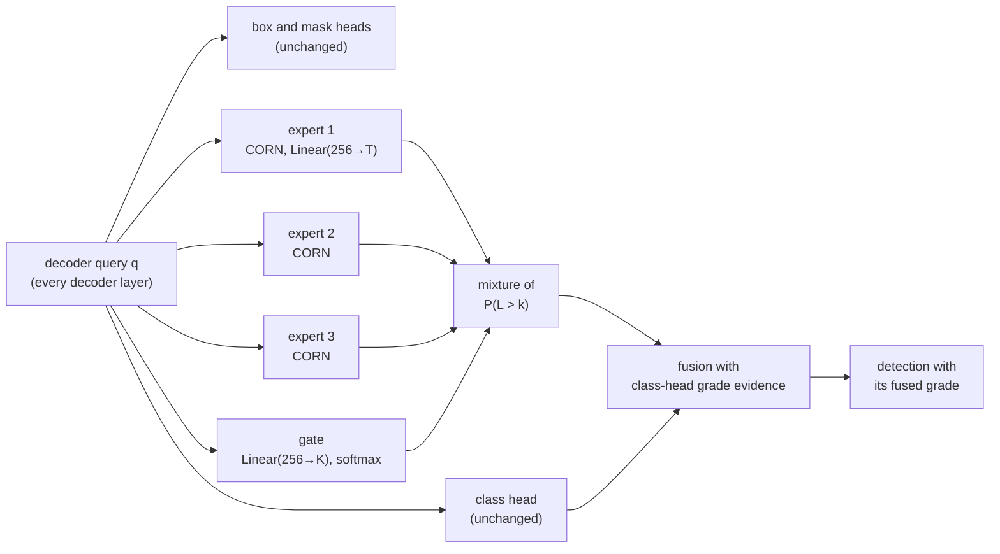

# DinoV3-DETR

DinoV3-DETR is a real-time model for object detection and instance segmentation built on [RF-DETR](https://github.com/roboflow/rf-detr) (Robinson et al., 2026). It adds two things to RF-DETR. The first is a new backbone, Meta's [DINOv3](https://github.com/facebookresearch/dinov3) vision transformer (Siméoni et al., 2025), in place of DINOv2. The second is an optional **mixture-of-experts (MoE) ordinal head** for label sets whose classes carry an ordered grade, such as rock-mass quality A to E or damage from slight to severe. The decoder, multi-scale projector, training loop and export path are RF-DETR's own, so the code base is a fork of RF-DETR rather than a new detector. We keep RF-DETR's licence, copyright headers and citation, and readers should treat this repository as derived work built on RF-DETR.

| Component        | RF-DETR                       | DinoV3-DETR                                                         |
| ---------------- | ----------------------------- | ------------------------------------------------------------------- |
| Backbone         | DINOv2 with registers         | DINOv3 (ViT-S/16 default, S+/B/L/H+ selectable)                     |
| Position encoding | learned absolute, interpolated | 2D RoPE, any input divisible by `16 × num_windows`                |
| Class head       | independent sigmoids          | independent sigmoids, plus an optional MoE ordinal head for graded classes |
| Decoder, projector, losses, export | RF-DETR          | unchanged                                                           |

## The DINOv3 backbone

The backbone change replaces RF-DETR's DINOv2-with-registers encoder with a DINOv3 ViT pretrained on LVD-1689M. DINOv3 differs from DINOv2 in three ways that the port has to handle. It uses 16-pixel patches, which matches the patch size that RF-DETR Nano, Small, Medium and Large already use, so the projector and decoder need no change. It carries four register tokens next to the CLS token. It encodes position with 2D rotary embeddings (RoPE) on the patch tokens instead of a learned absolute table, so the encoder accepts any input whose sides are divisible by `16 × num_windows` without interpolating weights, and export needs no position-table freeze.

We keep RF-DETR's windowed attention, in which layers that do not feed the decoder attend inside `num_windows × num_windows` windows while the output layers attend globally. Each window keeps its patches' global RoPE coordinates, so a windowed layer computes exactly the attention of the global layer restricted to that window, and the prefix tokens (CLS and registers) are copied into every window and averaged afterwards. We switch off DINOv3's RoPE coordinate augmentation (`pos_embed_rescale`) so that the detector sees the same patch coordinates in training and evaluation. The encoder plugs into RF-DETR through its backbone registry (`rfdetr.models.backbone.register_backbone`), so layer-wise learning-rate decay, the drop-path schedule, gradient checkpointing and LoRA work unchanged. The implementation is in `src/rfdetr/models/backbone/dinov3.py`.

## Models

DinoV3-DETR comes in two families, detection models that predict boxes and segmentation models that predict a box and a mask for every instance. Both families use a DINOv3 ViT-S/16 encoder by default.

### Object detection

Each detection model keeps the decoder, query count and resolution of the RF-DETR variant it is built from, because RF-DETR's detection models already use 16-pixel patches.

| Class              | Name                 | Built on       | Resolution | Default encoder         |
| ------------------ | -------------------- | -------------- | ---------- | ----------------------- |
| `DinoV3DETRNano`   | `dinov3-detr-nano`   | RF-DETR Nano   | 384        | `dinov3_windowed_small` |
| `DinoV3DETRSmall`  | `dinov3-detr-small`  | RF-DETR Small  | 512        | `dinov3_windowed_small` |
| `DinoV3DETRMedium` | `dinov3-detr-medium` | RF-DETR Medium | 576        | `dinov3_windowed_small` |
| `DinoV3DETRLarge`  | `dinov3-detr-large`  | RF-DETR Large  | 704        | `dinov3_windowed_small` |

### Instance segmentation

RF-DETR's segmentation models use 12-pixel patches, which DINOv3 cannot load, so each segmentation model switches to 16-pixel patches and raises the resolution to keep the patch grid, and with it the encoder cost, of the RF-DETR variant. The mask head, decoder and query count are unchanged.

| Class                 | Name                     | Built on           | Resolution (RF-DETR) | Patch grid | Queries |
| --------------------- | ------------------------ | ------------------ | -------------------- | ---------- | ------- |
| `DinoV3DETRSegNano`   | `dinov3-detr-seg-nano`   | RF-DETR Seg Nano   | 416 (312)            | 26 × 26    | 100     |
| `DinoV3DETRSegSmall`  | `dinov3-detr-seg-small`  | RF-DETR Seg Small  | 512 (384)            | 32 × 32    | 100     |
| `DinoV3DETRSegMedium` | `dinov3-detr-seg-medium` | RF-DETR Seg Medium | 576 (432)            | 36 × 36    | 200     |
| `DinoV3DETRSegLarge`  | `dinov3-detr-seg-large`  | RF-DETR Seg Large  | 672 (504)            | 42 × 42    | 200     |

### Encoder sizes

Any of the five LVD-1689M DINOv3 sizes can be selected through the `encoder` argument, and dropping `windowed_` from the name gives global attention in every layer. The parameter counts below were measured on the built encoders.

| Size   | Encoder name              | Hugging Face weights                           | Encoder parameters |
| ------ | ------------------------- | ---------------------------------------------- | ------------------ |
| ViT-S  | `dinov3_windowed_small`   | `facebook/dinov3-vits16-pretrain-lvd1689m`     | 21.6 M             |
| ViT-S+ | `dinov3_windowed_splus`   | `facebook/dinov3-vits16plus-pretrain-lvd1689m` | 28.7 M             |
| ViT-B  | `dinov3_windowed_base`    | `facebook/dinov3-vitb16-pretrain-lvd1689m`     | 85.7 M             |
| ViT-L  | `dinov3_windowed_large`   | `facebook/dinov3-vitl16-pretrain-lvd1689m`     | 303.1 M            |
| ViT-H+ | `dinov3_windowed_hplus`   | `facebook/dinov3-vith16plus-pretrain-lvd1689m` | 840.6 M            |

## Installation

The package installs as `rfdetr`, the same import name as upstream, so it should go into its own environment. It needs Python 3.10 or newer, PyTorch 2.5 or newer and transformers 5.x.

```bash
git clone https://github.com/Sompote/DinoV3-DETR.git
cd DinoV3-DETR
pip install -e ".[train]"
```

The DINOv3 weights are gated on the Hugging Face Hub. Accept the licence on the model page of the encoder you want (for ViT-S, [facebook/dinov3-vits16-pretrain-lvd1689m](https://huggingface.co/facebook/dinov3-vits16-pretrain-lvd1689m)) and log in once before the first training run.

```bash
hf auth login
```

## Usage

Training follows the RF-DETR API. An object detection model trains on a dataset with box annotations in COCO or YOLO format.

```python
from rfdetr import DinoV3DETRSmall

model = DinoV3DETRSmall()
model.train(dataset_dir="<DATASET_PATH>", epochs=100, batch_size="auto", lr=1e-4)
```

An instance segmentation model trains the same way on a dataset with polygon annotations (COCO segmentation or YOLO segmentation format), and its predictions carry one mask per instance in `detections.mask`.

```python
from rfdetr import DinoV3DETRSegSmall

model = DinoV3DETRSegSmall()
model.train(dataset_dir="<SEGMENTATION_DATASET_PATH>", epochs=100, batch_size="auto", lr=1e-4)

detections = model.predict("image.jpg", threshold=0.5)
masks = detections.mask  # (num_instances, height, width) boolean array
```

A larger encoder is selected when the model is built, for detection and segmentation models alike, and inference works as in RF-DETR.

```python
from rfdetr import DinoV3DETRMedium

model = DinoV3DETRMedium(encoder="dinov3_windowed_base")
detections = model.predict("image.jpg", threshold=0.5)
```

## The mixture-of-experts ordinal head

### Why an ordinal head

Some label sets hide an ordered grade inside the class. The rock-mass codes `A01 … E03` grade rock quality from A to E with three sub-codes each, and damage classes run from slight to severe. RF-DETR's class head scores every class with an independent sigmoid, so its loss treats a one-grade error exactly like a four-grade error and has no notion that grade B lies between A and C. Building the ordinal model *into* the class head was tried in the rock study and cost detection, because the factorised scores couple sibling classes. The MoE ordinal head therefore sits *beside* the class head. It reads the same decoder query and predicts only the grade, so the class head still decides which objects exist and how confident they are, and the boxes and masks are untouched.

### Architecture



The head has `K` experts (three by default) and a gate, all reading the decoder query $\mathbf{q}$. For `L` ordered grades there are $T = L - 1$ thresholds, and each expert $e$ is a CORN ordinal regressor (Shi et al., 2023) that builds the exceedance probabilities as a chain product of conditional sigmoids,

$$P_e(L > k) = \prod_{j=0}^{k} \sigma\left(\mathbf{w}_{e,j}^\top \mathbf{q} + b_{e,j}\right), \qquad k = 0, \dots, T-1.$$

Every factor lies between 0 and 1, so $P_e(L > k)$ can only fall as $k$ rises and the grade probabilities are never negative. The gate gives each expert a weight $g = \mathrm{softmax}(W_g \mathbf{q} + b_g)$, in the manner of the classical mixture of experts (Jacobs et al., 1991), and the experts are mixed on their cumulative probabilities,

$$C_k = \sum_{e=1}^{K} g_e\, P_e(L > k).$$

A convex combination of non-increasing sequences is non-increasing, so the mixture stays rank-consistent. The head returns the conditional logits of the mixture, $z_k = \mathrm{logit}(C_k / C_{k-1})$ with $C_{-1} = 1$, which lets the loss and the fusion be written once for a single CORN head and reuse it unchanged for the mixture. The grade probabilities follow as $P(A) = 1 - C_0$, $P(B) = C_0 - C_1$, and so on up to $P(E) = C_{T-1}$. The idea behind the gate is that images from different sources, such as close-up tunnel-boring-machine faces and drill-and-blast faces, may grade on different visual cues, and each expert can take one of them.

### Training and inference

The head trains only on the queries that the Hungarian matcher assigns to a graded object, so unmatched queries and ungraded classes never touch it. The loss is the CORN conditional binary cross-entropy, in which threshold $k$ is trained only on objects whose true grade is at least $k$, and it is added at every decoder layer with a weight equal to the classification loss weight. The matcher, the classification loss and the box, mask and IoU losses are unchanged. At inference the head multiplies its grade distribution with the grade evidence of the class head (the best class score within each grade), picks the grade with the largest product, and moves the detection's best score to that grade while keeping the sub-class the class head chose. The post-processor, mask painting and evaluation tools then run unchanged, and exported models carry the same fusion.

The threshold biases are set so that a zero query gives a uniform grade distribution, the gate starts at equal weights, and the expert weights start random so that the experts can specialise. With three experts on a 256-wide query the head adds 3,855 parameters, about 0.01 % of a medium model, and `ordinal_experts=1` reduces it to a single CORN head without a gate.

### Using it

The head is off by default and is switched on through five model arguments, and it works with every detection and segmentation model in this repository.

| Argument              | Default | Meaning                                                                    |
| --------------------- | ------- | -------------------------------------------------------------------------- |
| `ordinal_levels`      | `0`     | Number of ordered grades; `0` switches the head off                         |
| `ordinal_subclasses`  | `1`     | Classes per grade inside the graded block                                   |
| `ordinal_experts`     | `3`     | Number of experts mixed by the gate; `1` gives a single CORN head           |
| `ordinal_loss_weight` | `1.0`   | Grading loss weight relative to the classification loss                     |
| `ordinal_fuse`        | `True`  | Fuse the grade into the class scores at inference and in exported models    |

The graded classes must be the first `ordinal_levels × ordinal_subclasses` class ids, laid out level-major (every sub-class of grade A, then of grade B, and so on), and any class after that block, such as a shotcrete class, is left ungraded. The example below is the rock-mass label set, with five grades of three sub-codes each and one ungraded class.

```python
from rfdetr import DinoV3DETRSegMedium

model = DinoV3DETRSegMedium(num_classes=16, ordinal_levels=5, ordinal_subclasses=3, ordinal_experts=3)
model.train(dataset_dir="<ROCK_DATASET_PATH>", epochs=15, batch_size=8, grad_accum_steps=2, lr=1e-4)
```

### Cautions and evidence

After fusion each query carries a single graded class, whereas the stock post-processor emits two or three class hypotheses per query, which COCO mAP rewards. The validator's mAP therefore drops even when boxes and masks are identical, so judge the head on grading metrics such as exact-grade accuracy, within-one-grade accuracy or quadratic weighted kappa. The head trains on few queries, about two matched objects per image per query group, so it can over-fit on long schedules, and a short schedule or checkpoint selection on a validation grading metric is safer. Nothing forces the experts to differ, and no load-balancing term is used, so inspect the mean gate weights per image source before reading the experts as specialised.

The head comes from a rock-mass grading study on RF-DETR-Seg-M (401 test images, 15 epochs). At one training seed the three-expert head gave the largest grading gain of any variant over the stock model, with within-one-grade accuracy rising from 0.864 to 0.926 and quadratic weighted kappa from 0.705 to 0.785. At a second seed all variants sat within noise of each other, and the stock model itself moved by 0.03 in within-one accuracy between the two seeds. Treat the head as promising rather than proven until it has been compared over several seeds on your data. These figures come from RF-DETR with a DINOv2 backbone, and the head has not yet been measured on a DINOv3 backbone.

The [RF-DETR documentation](https://rfdetr.roboflow.com) covers dataset formats, training options, segmentation heads and export, and all of it applies here.

## Status and limitations

No COCO-pretrained DinoV3-DETR checkpoint exists, for detection or for segmentation. RF-DETR's published checkpoints contain DINOv2 encoder weights, so every DinoV3-DETR model starts from the DINOv3 encoder weights with a randomly initialised projector and decoder. Expect it to need longer training on small datasets than an RF-DETR model fine-tuned from COCO, and do not assume that it is more accurate until it has been measured on your data. We have not yet benchmarked DinoV3-DETR on COCO or any other dataset, so this README reports no accuracy or speed figures.

The port has been checked with randomly initialised encoders on an RTX 3080 (PyTorch 2.8, transformers 5.19). With global attention, the encoder's feature maps match the Hugging Face `DINOv3ViTModel` hidden states exactly (maximum absolute difference 0.0). A windowed layer matches a per-window reference computation to 0.0, and gradient checkpointing reproduces the plain forward pass. All four detection models and all four segmentation models build, run a mixed-precision training step and predict, and the segmentation models return one full-resolution mask per query, and `tests/models/backbone/test_dinov3.py` holds these checks, which pass together with RF-DETR's 117 existing backbone tests. The pretrained DINOv3 weights themselves have not yet been loaded in a test, because that needs gated Hub access. Two RF-DETR features stay DINOv2-only: input channel counts other than three (`num_channels`), and the split-einsum attention rewrite in the Apple Neural Engine export, which is written for DINOv2 layers. ONNX, TensorRT and the other export formats have not yet been run on a DinoV3-DETR model.

The MoE ordinal head has been checked in the same way, on an RTX A4000. Its tests in `tests/models/heads/test_ordinal.py` confirm that the vectorised CORN loss equals the per-threshold reference loop, that the gated mixture stays monotone and equals the gate-weighted expert probabilities, that a single expert reduces to a plain CORN head, and that fusion keeps each detection's best score and sub-class while leaving ungraded classes untouched. A 3-epoch training run of `DinoV3DETRSegNano` with the head on a synthetic four-class segmentation set logged `loss_ordinal` at every decoder layer, moved the gate away from its zero start, saved and reloaded the head exactly, and predicted masks from the reloaded checkpoint. This run checks the wiring only, with a randomly initialised encoder, and says nothing about grading accuracy.

## Citation

DinoV3-DETR is based on RF-DETR. If you use this code, please cite RF-DETR and DINOv3, and cite CORN and the mixture-of-experts paper as well if you use the MoE ordinal head.

```bibtex
@inproceedings{robinson2026rfdetr,
  title     = {RF-DETR: Real-Time Detection Transformer},
  author    = {Robinson, Isaac and Robicheaux, Peter and Popov, Matvei and Ramanan, Deva and Peri, Neehar},
  booktitle = {International Conference on Learning Representations (ICLR)},
  year      = {2026},
  url       = {https://arxiv.org/abs/2511.09554}
}

@article{simeoni2025dinov3,
  title   = {{DINOv3}},
  author  = {Sim{\'e}oni, Oriane and Vo, Huy V. and Seitzer, Maximilian and Baldassarre, Federico and Oquab, Maxime and Jose, Cijo and Khalidov, Vasil and Szafraniec, Marc and Yi, Seungeun and Ramamonjisoa, Micha{\"e}l and Massa, Francisco and Haziza, Daniel and Wehrstedt, Luca and Wang, Jianyuan and Darcet, Timoth{\'e}e and Moutakanni, Th{\'e}o and Sentana, Leonel and Roberts, Claire and Vedaldi, Andrea and Tolan, Jamie and Brandt, John and Couprie, Camille and Mairal, Julien and J{\'e}gou, Herv{\'e} and Labatut, Patrick and Bojanowski, Piotr},
  journal = {arXiv preprint arXiv:2508.10104},
  year    = {2025}
}

@article{shi2023corn,
  title   = {Deep Neural Networks for Rank-Consistent Ordinal Regression Based on Conditional Probabilities},
  author  = {Shi, Xintong and Cao, Wenzhi and Raschka, Sebastian},
  journal = {Pattern Analysis and Applications},
  volume  = {26},
  pages   = {941--955},
  year    = {2023}
}

@article{jacobs1991moe,
  title   = {Adaptive Mixtures of Local Experts},
  author  = {Jacobs, Robert A. and Jordan, Michael I. and Nowlan, Steven J. and Hinton, Geoffrey E.},
  journal = {Neural Computation},
  volume  = {3},
  number  = {1},
  pages   = {79--87},
  year    = {1991}
}
```

## Licence

The code is released under the Apache License 2.0, the licence of RF-DETR, and the original Roboflow, Baidu (LW-DETR), Microsoft (Conditional DETR) and Facebook (DETR) copyright notices are kept in the source files. The DINOv3 weights are distributed by Meta under the separate DINOv3 License, which you accept on the Hugging Face model page and which governs any use of the pretrained encoder.
